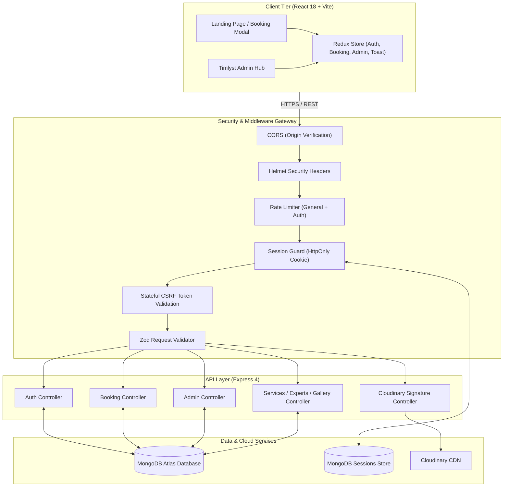

<div align="center">

# ✨ BOOKEASE ✨
### *Next-Generation Luxury Salon & Enterprise Appointment Booking Platform*

[](https://react.dev/)
[](https://www.typescriptlang.org/)
[](https://nodejs.org/)
[](https://expressjs.com/)
[](https://www.mongodb.com/)
[](https://tailwindcss.com/)
[](https://cloudinary.com/)
[](https://vitejs.dev/)

<p align="center">
  <b>A full-stack, production-engineered appointment scheduling ecosystem combining a high-converting luxury salon customer experience with an enterprise-grade administrative command hub.</b>
</p>

[✨ Key Features](#-key-features) • [🏛️ System Architecture](#️-system-architecture) • [🛠️ Tech Stack](#️-tech-stack) • [⚡ Quick Start](#-quick-start) • [🔐 Security & Hardening](#-security--production-hardening) • [📡 API Reference](#-rest-api-reference) • [🧪 Testing](#-testing--quality-assurance)

---

</div>

## 🌟 Executive Overview

**BookEase** bridges the gap between client convenience and back-office salon operations. Designed to emulate the refined visual standards of luxury beauty brands (*"Perfect Darshan"*) while providing the schedule density and financial clarity of modern SaaS systems (*"Timlyst"*).

```
   ┌─────────────────────────────────────────────────────────────────┐
   │                       BOOKEASE ECOSYSTEM                        │
   ├────────────────────────────────┬────────────────────────────────┤
   │    💎 LUXURY CLIENT PORTAL     │   📊 ENTERPRISE ADMIN COMMAND   │
   │  • High-converting Hero & CTA  │  • Real-Time Revenue Analytics │
   │  • Filterable Treatment Catalog│  • Dual Calendar & List Views  │
   │  • 4-Step Real-time Booking    │  • Live Status Workflow Engine │
   │  • Double-Booking Prevention   │  • Dynamic Cloudinary Media Hub│
   │  • Customer Booking History    │  • Role-Based Access Control   │
   │  • Smooth In-App Screen Modals │  • WhatsApp & Preview Sharing  │
   └────────────────────────────────┴────────────────────────────────┘
```

---

## ✨ Key Features

### 💎 Client-Facing Experience (*Perfect Darshan Luxury Aesthetic*)
- **Hero & Brand Storytelling**: Engaging hero section featuring background salon ambiance, headline *"Transform Your Look at Perfect Darshan"*, and instantaneous *"Book Appointment"* actions.
- **Accreditation Badges**: Trust-building indicators:
  - 🕒 *Open Daily 10:00 AM – 8:00 PM*
  - 🏆 *Award Winning Best Salon 2024*
  - 🌿 *100% Hygienic Premium Organic Products*
- **Interactive 4-Step Booking Engine**:
  1. **Select Service**: Filterable catalog by category (Hair, Skin, Spa, Bridal) with live duration and pricing.
  2. **Select Date & Time Slot**: Smart date picker with dynamic capacity calculation, disabling booked slots in real time.
  3. **Client Details**: Name, phone, email, personalized styling notes, and auto-reminder preferences.
  4. **Confirmation**: Instant booking code generation (e.g., `REF: BKE-9482`) with direct sync to MongoDB.
- **Client Appointments Portal (`/my-bookings`)**:
  - View upcoming and historical visits with live status badges.
  - Cancel or permanently delete appointment records with custom in-app confirmation modals.
- **Customer Inquiry Desk**: Real-time contact form synchronized directly to the admin query inbox.

---

### 📊 Administrative Dashboard (*Timlyst Aesthetic*)
- **Executive KPI Row**:
  - **Total Appointments**: Live count of all historical and active bookings.
  - **Upcoming Appointments**: Scheduled visits requiring staff readiness.
  - **Completed Appointments**: Successfully serviced bookings for the current period.
  - **Total Revenue**: Aggregated financial intake in CAD ($) dynamically computed from confirmed & completed appointments.
- **Dual Schedule Views**:
  - **Calendar View**: Interactive monthly grid featuring real-time appointment chips (e.g., `5:00 AM John`, `11:00 AM Julie`) with intuitive date filtering.
  - **List / Table View**: Comprehensive management table with status pills, customer phone/email, price, and one-click actions (`Confirm`, `Complete`, `Cancel`, `Delete`).
- **Interactive Header Command Suite**:
  - 🔗 **Share Action**: Instant dropdown with direct booking link copy and one-click WhatsApp sharing (`https://wa.me/?text=...`).
  - 🔔 **Live Notification Center**: Live database alert badge highlighting new appointments with one-click navigation.
  - 👤 **Administrator Profile**: Quick account details, role indicator, and secure session sign out.
- **Dynamic Content & Media Management**:
  - **Services CRUD**: Add, edit, toggle active status, and remove salon treatments.
  - **Stylist Team Hub**: Manage master stylist profiles, experience, specialties, and ratings with signed Cloudinary image uploads.
  - **Portfolio Gallery Showcase**: Upload and manage high-resolution salon transformations dynamically stored in MongoDB.
  - **Reviews & Testimonials**: Verified client reviews management.
  - **Contact Inquiries**: Triage incoming client questions (`new` ➔ `read` ➔ `replied`).
- **Zero Browser Popups**: All deletions and status cancellations are guarded by modern, backdrop-blurred **In-App Screen Modals** (`ConfirmModal.tsx`).

---

## 🛠️ Tech Stack

<div align="center">

| Layer | Technologies | Purpose |
|:---|:---|:---|
| **Frontend Framework** | **React 18.3**, **TypeScript 5.7**, **Vite 6.4** | High-performance SPA with strict type safety |
| **State Management** | **Redux Toolkit 2.5**, **React-Redux 9.2** | Centralized global store for auth, bookings, admin & toasts |
| **Styling & UI** | **Tailwind CSS 3.4**, **Lucide Icons**, **Radix UI** | Modern responsive design with glassmorphism & rich micro-animations |
| **Backend Runtime** | **Node.js 22**, **Express 4.21** (ESM) | Scalable REST API architecture |
| **Database & ODM** | **MongoDB Atlas**, **Mongoose 8.9** | Document database with schematized relational validation |
| **Session & Auth** | **express-session**, **connect-mongo**, **bcryptjs** | HttpOnly cookie sessions backed by persistent Mongo store |
| **Cloud Media** | **Cloudinary v2 API** | Signed, secure asset uploads for stylists, gallery & avatars |
| **Validation & Security** | **Zod 3.24**, **Helmet 8.0**, **express-rate-limit** | Strict schema parsing, security headers, and rate protection |
| **Testing** | **Vitest 2.1**, **Supertest 7.0**, **Testing Library** | End-to-end integration and unit testing |

</div>

---

## 🏛️ System Architecture



---

## 🔐 Security & Production Hardening

- **Stateful HttpOnly Sessions**: Authentication relies on encrypted, tamper-proof session cookies stored in MongoDB via `connect-mongo`. No JWTs stored in vulnerable `localStorage`.
- **Automatic CSRF Rotation**: Custom stateful anti-CSRF token verification on mutating HTTP methods (`POST`, `PUT`, `PATCH`, `DELETE`).
- **Conflict & Overlap Guard**: Database transactions and slot queries prevent accidental double-bookings for identical service slots.
- **Strict Role-Based Access Control (RBAC)**: Enforced via `requireAuth` and `requireAdmin` middleware guards.
- **Zod Schema Contracts**: 100% of incoming payloads (registrations, bookings, service creations, status patches) are validated before touching business logic.
- **Signed Cloudinary Uploads**: Direct client-to-Cloudinary uploads utilize backend-generated cryptographic HMAC SHA-1 signatures with 1-hour expiration timestamps.

---

## 📁 Repository Structure

```
Salon/
├── backend/
│   ├── src/
│   │   ├── config/          # Database connection, env, Cloudinary & session setup
│   │   ├── controllers/     # Auth, Booking, Admin, Service, Expert, Gallery, Query
│   │   ├── middleware/      # Auth guard, RBAC, CSRF, Rate Limiting, Error Handler
│   │   ├── models/          # User, Booking, Service, Expert, Gallery, Testimonial, Query
│   │   ├── routes/          # Express route definitions
│   │   ├── schemas/         # Zod schemas for input validation
│   │   └── server.ts        # Express app initialization & server entrypoint
│   ├── scripts/             # Seed demo data (`seed-demo.ts`, `promote-admin.ts`)
│   └── tests/               # Backend integration tests (Vitest + Supertest)
│
├── frontend/
│   ├── src/
│   │   ├── api/             # Typed API clients (Auth, Booking, Admin, Expert, Gallery)
│   │   ├── components/
│   │   │   ├── admin/       # Calendar, List, MetricCards, Overview, Header, Sidebar
│   │   │   ├── booking/     # 4-step interactive booking modal
│   │   │   ├── common/      # Navbar, Footer, ConfirmModal, Toast, ImageUploadBox
│   │   │   └── home/        # Hero, Services, Experts, Gallery, Testimonials, Contact
│   │   ├── pages/           # HomePage, AdminDashboardPage, MyBookingsPage, AuthPages
│   │   ├── store/           # Redux slices (auth, booking, admin, toast)
│   │   ├── types/           # Shared TypeScript interfaces & models
│   │   └── App.tsx          # Router configuration and application shell
│   └── public/              # Static assets and favicon
│
└── README.md                # Project documentation
```

---

## ⚡ Quick Start

### 📋 Prerequisites
- **Node.js** v18+ (v20 or v22 recommended)
- **MongoDB** (Local instance or MongoDB Atlas cluster URL)
- **Cloudinary Account** (Free tier for media uploads)

---

### 1️⃣ Clone & Configure Backend

```bash
# Navigate to backend
cd backend

# Create .env configuration
cp .env.example .env
```

Edit `backend/.env` with your credentials:
```ini
PORT=5000
NODE_ENV=development
CLIENT_ORIGIN=http://localhost:5173
MONGODB_URI=mongodb+srv://<username>:<password>@cluster0.mongodb.net/bookease?retryWrites=true&w=majority
SESSION_SECRET=your_super_secret_64_character_random_string_here

# Cloudinary Configuration
CLOUDINARY_CLOUD_NAME=your_cloud_name
CLOUDINARY_API_KEY=your_api_key
CLOUDINARY_API_SECRET=your_api_secret
```

---

### 2️⃣ Seed Initial Data

Populate treatments, stylists, portfolio items, client reviews, and scheduled demo bookings:
```bash
cd backend
npm run seed:demo
```

> **Pre-configured Demo Accounts:**
> | Role | Email | Password |
> |---|---|---|
> | 👑 **Admin** | `admin@bookease.com` | `Password123!` |
> | 👤 **Client** | `customer@bookease.com` | `Password123!` |

---

### 3️⃣ Start Development Servers

**Terminal 1 (Backend API):**
```bash
cd backend
npm run dev
# Running on http://localhost:5000
```

**Terminal 2 (Frontend Client):**
```bash
cd frontend
npm run dev
# Running on http://localhost:5173
```

Visit **[http://localhost:5173](http://localhost:5173)** in your browser!

---

## 📡 REST API Reference

| Domain | Method | Endpoint | Description | Auth |
|:---|:---|:---|:---|:---|
| **Auth** | `POST` | `/api/auth/register` | Register new customer account | Public |
| **Auth** | `POST` | `/api/auth/login` | Sign in with email & password | Public |
| **Auth** | `GET` | `/api/auth/me` | Fetch active authenticated session user | Authenticated |
| **Auth** | `POST` | `/api/auth/logout` | Terminate session & clear cookie | Authenticated |
| **Bookings** | `GET` | `/api/bookings/my` | Retrieve logged-in user appointments | Authenticated |
| **Bookings** | `POST` | `/api/bookings` | Create new appointment reservation | Authenticated |
| **Bookings** | `PATCH` | `/api/bookings/:id/cancel` | Cancel an upcoming booking | Customer / Admin |
| **Bookings** | `DELETE` | `/api/bookings/:id` | Permanently remove appointment record | Customer / Admin |
| **Admin** | `GET` | `/api/admin/dashboard` | Fetch KPI metrics, breakdown & recent visits | Admin Only |
| **Admin** | `GET` | `/api/admin/bookings` | Retrieve all bookings with filters | Admin Only |
| **Admin** | `PATCH` | `/api/admin/bookings/:id/status` | Update booking status (`confirmed`, etc.) | Admin Only |
| **Admin** | `POST` | `/api/admin/bookings` | Manual walk-in / phone booking entry | Admin Only |
| **Admin** | `DELETE` | `/api/admin/bookings/:id` | Hard delete appointment from database | Admin Only |
| **Services** | `GET` | `/api/services` | Retrieve all active salon treatments | Public |
| **Services** | `POST` | `/api/services` | Create new salon service | Admin Only |
| **Uploads** | `POST` | `/api/upload/sign` | Generate signed Cloudinary upload params | Admin Only |
| **Experts** | `GET` / `POST` | `/api/experts` | View / add salon master stylists | Public / Admin |
| **Gallery** | `GET` / `POST` | `/api/gallery` | View / add portfolio gallery images | Public / Admin |
| **Queries** | `POST` / `GET` | `/api/queries` | Submit contact form / view customer messages | Public / Admin |

---

## 🧪 Testing & Quality Assurance

Both frontend and backend are protected with comprehensive type checking, automated unit/integration suites, and production build checks.

<div align="center">

| Test Scope | Target Engine | Command | Result |
|:---|:---|:---|:---|
| **Backend Static Analysis** | TypeScript 5.7 | `node ./node_modules/typescript/bin/tsc --noEmit` | **0 Errors (Passed)** |
| **Backend Integration Suite** | Vitest 2.1 + Supertest | `npm run test` | **7/7 Passed (100%)** |
| **Frontend Static Analysis** | TypeScript 5.7 | `npm run typecheck` | **0 Errors (Passed)** |
| **Frontend Production Build** | Vite 6.4 Rollup | `npm run build` | **1654 modules bundled (Passed)** |

</div>

---

## 💡 Best Practices Implemented

- ⚡ **No UI Flash**: Initial auth state restored seamlessly with persistent Mongo sessions and optimistic UI states.
- 🎨 **Accessibility & Responsiveness**: Mobile-first responsive grids, keyboard accessibility (`Esc` dismisses modals), and focus trapping.
- 🚫 **Zero Native Browser Alerts**: All actions rely on custom in-screen animated toast notifications and backdrop-blurred confirmation modals.
- 🔄 **Real-Time Data Refresh**: Redux slices automatically invalidate and refetch data upon mutations for instant state synchronization.

---

<div align="center">

**Crafted with care for luxury salon experiences & modern business management.**  
*© 2026 BookEase. All rights reserved.*

</div>
